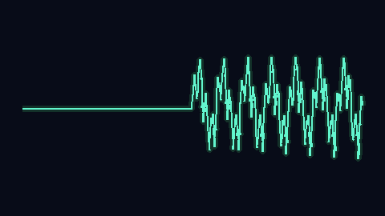
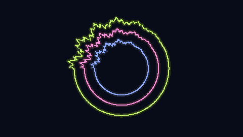
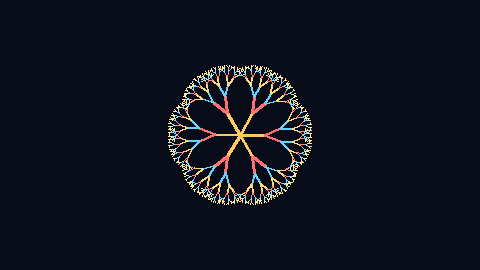

# Audio / Form

Turn an audio recording into an animated video, entirely on your computer.
Choose from nine visual styles and three color palettes, try a temporary preview,
and export a video with your original soundtrack.

## Download and run on Windows

Open this repository's **Releases** section and download
**Audio-Form-0.1.0-windows-x64.zip** from the release's Assets list.
Choose the application ZIP, not GitHub's automatic "Source code" download.

1. Right-click the ZIP and select **Extract All**.
2. Open the extracted folder and double-click **Audio Form.exe**.
3. Your browser opens the app. Keep the console window open while using it;
   close the console to stop the app.

The portable release includes Python, the required libraries, and FFmpeg 9.0.2.
No installation, account, or internet connection is required to run it. Use
Windows 10 or 11 on a 64-bit x86 PC. Keep the `_internal` and `ffmpeg` folders
beside the executable, and extract somewhere writable such as Documents.
The included **README.txt** explains the same steps in plain text.

The executable is unsigned. Windows may show an unknown-publisher warning.
Only run releases you trust; do not disable your security software. A SHA-256
file is provided alongside the ZIP to check download integrity.

## Animation examples

Silent, looping examples made from synthetic signals. 

| Line · Aurora | Circles · Orchid | Tree · Ember |
| --- | --- | --- |
|  |  |  |

The tree is named **Fractal** in the app.

## Run from source (optional)

The instructions below are for users who prefer running the Python source.
They are not needed for the portable Windows release.

### Requirements

- Python 3.10 or newer.
- A modern browser.
- Internet access for the initial dependency installation.

Windows includes a double-click launcher. macOS and Linux users can start the
same app from a terminal.

## Install

Download or clone this repository, then open a terminal in the project folder.

### Windows

```powershell
py -3 -m venv .venv
.\.venv\Scripts\python.exe -m pip install -e .
```

If `py` is unavailable, use `python` instead. You do not need to activate the
virtual environment.

### macOS and Linux

```sh
python3 -m venv .venv
.venv/bin/python -m pip install -e .
```

The dependencies include NumPy, Pillow, and imageio-ffmpeg. Install a current
FFmpeg build using the instructions below; the dependency's bundled version may
be older. The launcher prints the selected FFmpeg version when it starts.

### Use a current FFmpeg

For Windows, download the **release essentials ZIP** from the
[Windows build provider](https://www.gyan.dev/ffmpeg/builds/) linked by
[FFmpeg's official download page](https://ffmpeg.org/download.html). Compare the
ZIP's SHA-256 with the provider's `.sha256` file before using it:

```powershell
Get-FileHash .\ffmpeg-release-essentials.zip -Algorithm SHA256
```

Extract `bin/ffmpeg.exe` from that archive into this project at:

```text
.tools/ffmpeg/bin/ffmpeg.exe
```

The app automatically uses that executable. To update it later, stop the app,
download and verify the newer release, and replace that executable. The binary
is excluded from Git; source downloads need their own installation. The
portable release already contains it. FFmpeg 9.0.2 was tested with this app on October 14, 2026.

Alternatively, on any platform, set `IMAGEIO_FFMPEG_EXE` to the full path of your
maintained FFmpeg executable. This explicit setting takes priority over the
project-local copy. On Windows PowerShell, for example:

```powershell
$env:IMAGEIO_FFMPEG_EXE = "C:\Tools\ffmpeg\bin\ffmpeg.exe"
& ".\Start Studio.bat"
```

Without either setting, imageio-ffmpeg's bundled executable is used as a fallback.
Check its version before processing recordings from unknown sources.

## Open the app

When running from source on Windows, double-click **Start Studio.bat**. A console window opens and launches
the app in your default browser. Keep that console open while using the app.
Close it, or press **Ctrl+C**, to stop the server.

On macOS or Linux, run this from the project folder:

```sh
.venv/bin/python -m voice_animation.web
```

If the browser does not open automatically, copy the local address printed in
the console into your browser.

## Make a video

1. Drop an audio file into the app, or click to choose one. The maximum size is
   512 MB. Supported containers include MP3, WAV, FLAC, M4A/MP4, OGG, AAC,
   AIFF, Matroska/WebM, ASF, APE, and WavPack. Playlists and network streams
   are not accepted.
2. Choose a visual style and an Aurora, Ember, or Orchid palette.
3. Click **Preview 10 seconds** to try the beginning of the recording. Shorter
   recordings are previewed in full. The preview remains available for replay.
4. Click **Create video** to render the complete recording.
5. Watch the result in the browser or click **Download MP4**.

Completed videos are saved in the project's `outputs` folder with unique names.
The app creates this folder automatically. Existing exports are not overwritten.
One video is rendered at a time; longer recordings take more time to process.

The web app exports 1280 × 720 video at 30 frames per second, using H.264 video
and AAC audio. The soundtrack plays continuously and keeps its original channel
layout. Changing the visual style or palette does not change the audio volume.

## Styles and palettes

| Style | Appearance |
| --- | --- |
| Line | A horizontal waveform that follows your audio |
| Circles | Three rotating waveform rings |
| Fractal | Six branching trees with audio-driven movement |
| Snowflake | Nested snowflakes that grow finer detail with the sound |
| Automata orbit | Three independently rotating cellular bands |
| Dragon | Opposing folded spirals with brief echoes on audio accents |
| Brain sphere | A sphere of connected structures or expanding audio rings |
| Pythagoras | A rotating tree of squares that grows and retracts |
| Apollonian | A shifting arrangement of nested tangent circles |

Brain sphere offers **Connected structures** and **Audio rings** modes.
Every style supports all three palettes:

- **Aurora:** mint, lavender, and gold.
- **Ember:** gold, coral, and blue.
- **Orchid:** periwinkle, pink, and lime.

## Your files and temporary previews

Audio processing runs locally. The app listens only on your computer's loopback
address and does not send recordings to a cloud service. No account or API key
is required.

Your source recordings are left untouched. Temporary upload copies are removed
after rendering. Previews are kept in memory for playback, and their temporary
MP4 files are deleted once rendering completes. They clear when you leave the
page, replace them with another render, or close the app. Previews are not saved
in `outputs`; only **Create video** saves a full export.

The web app keeps uploads, decoded audio, and unfinished videos in its own
marked session folders under `.tmp/studio-sessions`. Normal shutdown removes
its session. After a crash or power loss, the next launch automatically removes
abandoned sessions. An operating-system lock protects sessions belonging to
another running instance. Locked files that cannot yet be removed are retried
on a later launch. Cleanup does not touch original recordings, completed exports,
unmarked folders, or symlink/junction targets.

Cleanup runs when the app starts; it cannot run while the computer is off.
Temporary files created by older app versions outside these session folders
are not automatically removed. Command-line renders retain their usual temporary
file handling and may leave unfinished files after a forced termination.

## Optional command-line use

After installation, you can also render without opening the web app. On Windows:

```powershell
.\.venv\Scripts\voice-animate.exe "input.mp3" "outputs\video.mp4" --style circles --palette orchid
```

On macOS or Linux, use `.venv/bin/voice-animate` instead.

| Option | Purpose |
| --- | --- |
| `--style "brain sphere"` | Choose a style; quote names containing spaces |
| `--brain-mode rings` | Select the brain sphere's rings mode |
| `--palette ember` | Choose aurora, ember, or orchid |
| `--duration 10` | Export only the first ten seconds |
| `--width 640 --height 360 --fps 24` | Change output size and frame rate |
| `--gain 4` | Increase visual sensitivity without changing audio volume |
| `--quality balanced` | Use slower encoding that may produce smaller files |
| `--orbit-seed 42` | Repeat an automata orbit starting state |
| `--overwrite` | Explicitly replace an existing output file |
| `--quiet` | Hide rendering progress |

Unlike the web app's temporary preview, a command-line export with `--duration`
is saved to the output path you specify. Dimensions must be even and at least
64 pixels. Run `voice-animate --help` for all options.

## Troubleshooting

- **The launcher reports a missing environment:** complete the installation
  commands from the project folder, then open the launcher again.
- **The page is disconnected:** reopen the launcher and use the new address it
  prints. Each launch can use a different port.
- **An audio file fails to render:** confirm it plays correctly, is under the
  upload limit, and uses a supported format. Try converting it to WAV or MP3.
- **Rendering is slow:** try the ten-second preview first. Detailed styles and
  long recordings require more processing time.

## Security and safe use

This app is intended for one person using their own computer. Do not expose its
server to a network or deploy it as a public upload service. Other programs or
users on the same computer are outside its access-control boundary.

The media decoder is a native FFmpeg executable. Keep it updated using the
instructions above.  See the official
[FFmpeg security notices](https://ffmpeg.org/security.html) and
[download options](https://ffmpeg.org/download.html). Treat recordings from
unknown sources cautiously and run the app without administrator privileges.

These controls do not sandbox FFmpeg or guarantee that every malformed file is
safe. Full-length renders can still use substantial processor time and disk
space; there is no total render-duration or disk-quota limit. Crash leftovers are cleaned on a later launch, as described above.
